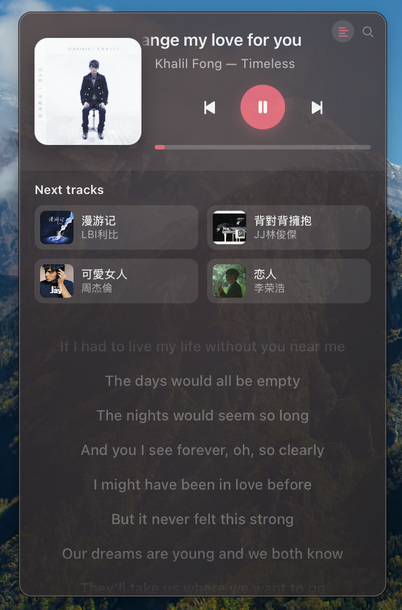

# Perch Player

Formerly Pear Music Widget. The bundle id, settings and caches keep the old
`pear-music-widget` names, so an upgrade keeps everything.

A floating now-playing widget and menu-bar player for macOS, with two sources:

- **YouTube Music:** a skin over the **API Server** plugin in
  [pear-desktop](https://github.com/pear-devs/pear-desktop) or
  [th-ch/youtube-music](https://github.com/th-ch/youtube-music), driven by its
  WebSocket.
- **Local Music:** a player of its own for music folders on disk or on an
  external drive. FLAC, WAV, MP3, AAC/ALAC, Ogg Vorbis and AIFF are decoded in
  the app, with no other player running.

Both sources share one card, with the same controls, queue, lyrics, search and
cover-tinted look.



## Two views

- **Menu-bar dropdown:** click the menu-bar icon for artwork, transport controls,
  progress, queue, lyrics and search. It closes on click-away or Escape, and
  reopens showing the queue or lyrics if you left one open.
- **Floating widget:** a resizable player that can sit anywhere on the desktop,
  optionally above other windows.

| Menu-bar gesture | Action |
| --- | --- |
| Left click | Toggle the dropdown |
| Double click | Show the floating widget and bring it to the front |
| Option-click or middle click | Play/pause |
| Right click | Open settings |

Right-clicking the dropdown or the floating widget opens a shorter menu for that
surface. The floating widget's close button hides it. Bring it back with a
menu-bar double-click or **Show floating widget**.

## Choosing a source

**Source** appears in all three right-click menus: the menu-bar icon, the
dropdown and the floating widget.

```
Source ▸
  ✓ YouTube Music
    Local Music
      ♥ Liked Songs (23)
  ─────────────
    Recent Folders
    Music — Crucial X6
  ─────────────
    Choose Folder…
    Remove from List ▸
```

- **Local Music** plays the folder you used last; **Recent Folders** keeps up to
  eight. A folder on a drive that isn't plugged in stays listed as *not
  connected* and comes back when the drive does.
- **Every folder resumes where you left it:** the same track and position,
  shuffle and repeat, and whether it was on Liked Songs.
- **Switching never starts music by itself.** The source you leave is paused, and
  the new one opens paused.

## Local Music

### Library

- **Folder layout:** any folder works. Tags (title, artist, album, embedded
  artwork) are used where present. Untagged files take their title from the
  filename, their album from the folder (dropping a `2001 - ` prefix), and their
  artist from the top-level folder in an `Artist/Album/` tree.
- **Fast reopening:** after the first scan, reopening a folder reads tags only
  for files that changed. A 360-track USB drive reopens in about 20 ms.
- **Search** in local mode searches the folder by title, artist and album.

### Covers

Embedded art or a `cover.jpg`/`folder.jpg` is used first. Files without any are
looked up online, in this order:

1. iTunes (Taiwan, then US store)
2. Deezer
3. iTunes song search, for folders of singles
4. YouTube Music's own search, when it's running

A cover is used only when both the artist and the album or title match. Covers
and misses are cached; a lookup that fails on the network is retried later, never
recorded as "no cover".

### Likes and Liked Songs

- **Like and dislike:** the heart button likes the current track, and
  right-clicking it dislikes. Pressing the state you're already in clears it.
- **Dislike skips:** disliked tracks are dimmed in the queue and skipped when
  playback advances. Disliking the playing track moves on, and picking a
  disliked track from the queue still plays it.
- **Liked Songs:** turns the queue into just your liked tracks, with shuffle and
  repeat working within them. A playing track that isn't liked finishes before
  the liked ones take over.
- **Ratings live on the drive** in `<folder>/.pear-music/likes.json`, so they
  travel with it. A rated file you rename or move inside the folder keeps its
  rating. If the drive can't be written, ratings are kept in Application Support
  and merged back when it can.

### Deleting

The **Delete** corner button appears for local tracks. It asks first, then moves
the file to the Trash on its own drive, where you can restore it.

## Controls

The corner bar holds **Delete** (local only), **Repeat**, **Queue**, **Lyrics**
and **Search**. Each can be hidden per layout, and the bar can hide itself when
idle.

- **Queue:** the full play order. Click any row, including one already played,
  to jump to it. The card also shows a six-track strip of what's next.
- **Lyrics:** synced, rolling lyrics when available. Click the middle of a line to
  seek, or scroll to browse.
  - **Timing:** sets a default offset. **Song Time** sets one for the current
    track, and **Custom…** accepts −20 to +20 seconds.
  - **Chinese:** Traditional Chinese can be shown as Simplified, and offline
    Jyutping can be added beneath Chinese lines.
- **Search:** use the pointer, or ↑/↓ and Enter. In YouTube mode the chosen
  result plays after the current track.
- **Volume:** drag the speaker popover, scroll over the card, or press ↑/↓ while
  focused. Hold Shift for 1% steps.
- **Keyboard:** while focused, Space plays/pauses and ←/→ jump five seconds.
- **Artist Names** maps a credit to the name you want shown, for example
  `Jaychou → 周杰伦`. It applies to both sources, and lyrics and cover lookups use
  the new name.

Also: shuffle, repeat-all/repeat-one, seeking, cover-derived tint, opacity,
light/dark appearance, always-on-top, remembered positions and sizes, native
vibrancy, and no Dock icon.

Lyrics come from three sources: [LRCLib](https://lrclib.net),
[Kugeci](https://www.kugeci.com) and YouTube Music's own lyrics. The order
depends on the source:

- **YouTube Music:** that track's own lyrics come first.
- **Local Music:** an exact LRCLib match on the file's tags and duration comes
  first. Kugeci is tried next for Chinese songs, then the same song is found on
  YouTube Music. Duration checks keep the timing to that recording.

Different recordings can still have different timings.

## Install

1. Download the DMG from the
   [latest release](https://github.com/TianCal/pear-music-widget/releases/latest).
2. Drag the app to Applications.
3. **For Local Music:** right-click the menu-bar icon, then choose **Source →
   Choose Folder…**.
4. **For YouTube Music:** enable the **API Server** plugin in YouTube Music,
   launch the widget, and approve its access-token request.

The app is ad-hoc signed but not notarised. If macOS blocks the first launch,
right-click the app and choose **Open**, or run:

```bash
xattr -dr com.apple.quarantine "/Applications/Perch Player.app"
```

Requires Apple Silicon. Built and tested on macOS 26.

## Privacy and data

The renderer never touches the network. Only two parts of the app talk to hosts
other than your own Mac: lyrics lookup and cover lookup for local files.
Everything else stays local.

| What | Where |
| --- | --- |
| Settings, recent folders, artist names | `~/Library/Application Support/pear-music-widget/settings.json` |
| Likes | `<folder>/.pear-music/likes.json` (fallback: `…/pear-music-widget/likes/`) |
| Lyrics cache (size set in **Lyrics → Cache**) | `~/Library/Caches/pear-music-widget/lyrics` |
| Cover cache | `~/Library/Caches/pear-music-widget/artwork` |
| Library index | `~/Library/Caches/pear-music-widget/library` |

Quit the app before editing `settings.json`. Unknown keys are preserved.

## Run from source

Install a [Rust toolchain](https://rustup.rs) and the Xcode command line tools.
There is no npm or bundler step.

```bash
cargo run --manifest-path src-tauri/Cargo.toml
cargo run --manifest-path src-tauri/Cargo.toml -- --doctor  # check YouTube Music connectivity
./scripts/reinstall-local.sh                               # rebuild and reinstall
```

To build a DMG, install `tauri-cli`, then run `cd src-tauri && cargo tauri build`.

Publishing requires an authenticated GitHub CLI and a clean, current `main`:

```bash
./scripts/publish-release.sh small  # patch
./scripts/publish-release.sh minor
./scripts/publish-release.sh major
```

## Compatibility

YouTube mode targets API Server `/api/v1` at `http://127.0.0.1:26538`, verified
against YouTube Music 3.12.0. Run `--doctor` if the widget stays on its setup
screen.

Transport icons are hand-authored SVG paths in [src/index.html](src/index.html),
and app and menu-bar icons are generated by [src-tauri/build.rs](src-tauri/build.rs).
Bundled Cantonese pronunciation data and its licences are documented in
[THIRD_PARTY_NOTICES.md](THIRD_PARTY_NOTICES.md). Read [AGENTS.md](AGENTS.md)
before changing the event payloads, playback, volume path, window geometry or
tray behaviour.
